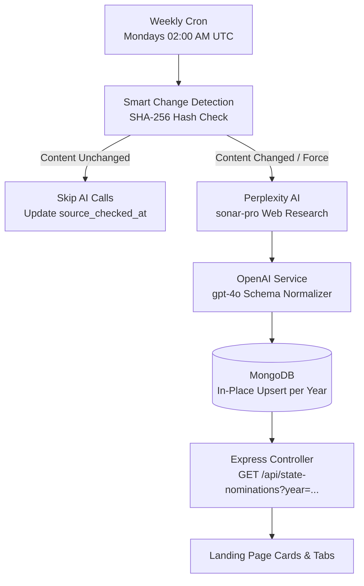

# Australian State Nominations Dynamic Sync & API Guide

## 1. Overview

This module automates the retrieval, validation, and serving of Australian General Skilled Migration state nomination statistics (Subclass 190 and Subclass 491) across all 8 Australian states and territories:

1. **New South Wales (NSW)**
2. **Victoria (VIC)**
3. **Queensland (QLD)**
4. **South Australia (SA)**
5. **Western Australia (WA)**
6. **Tasmania (TAS)**
7. **Australian Capital Territory (ACT)**
8. **Northern Territory (NT)**

### Key Business & Architectural Principles
- **Multi-Year Support**: Compare active program years (e.g. `2026-27`) with completed historical years (e.g. `2025-26`).
- **Weekly Cost-Saving Cron**: Runs **once a week** (Mondays at 02:00 UTC) matching official monthly government publication cycles.
- **Smart Change Detection**: Hashes public source tables before calling AI. If the table hasn't changed, AI calls are skipped completely ($0.00 cost).
- **In-Place Upsert**: Updates the record for the current program year in MongoDB rather than spamming 52 duplicate records a year.
- **Factual Integrity**:
  - `applicant_type: "ALL_APPLICANTS"` (accurately reflects Home Affairs total onshore + offshore reporting).
  - `<5` suppressed figures are stored as `reported_value: "<5"`, `value: null`, never invented as 2.
  - Actual reporting period (`Jul–Aug 2026`) and period end dates (`2026-08-31`) are separated from round dates.

---

## 2. Architecture & Data Flow



---

## 3. Quick Start & Seeding

### Initial Database Seeding
To populate both the completed historical **2025–26** allocations and the initial **2026–27** active baseline snapshot:

```bash
npm run seed:nominations
```

*This command is completely idempotent. You can run it anytime without creating duplicates.*

---

## 4. Required Environment Variables

Add these variables to your `.env` file:

```env
# ==============================================================
# AUSTRALIAN STATE NOMINATIONS AI & CRON CONFIGURATION
# ==============================================================

# Required for live sync: Perplexity API key
PERPLEXITY_API_KEY="pplx-xxxxxxxxxxxxxxxxxxxxxxxxxxxxxxxx"

# Required for live sync: OpenAI API key
OPENAI_API_KEY="sk-proj-xxxxxxxxxxxxxxxxxxxxxxxxxxxxxxxx"

# Optional: Cron schedule (Default: Weekly on Mondays at 02:00 AM UTC)
STATE_NOMINATION_CRON_SCHEDULE="0 2 * * 1"

# Optional: Cron timezone (Default: UTC)
CRON_TIMEZONE="UTC"

# Optional: Set to true to disable the cron worker
DISABLE_STATE_NOMINATION_CRON="false"

# Optional: Set to true to trigger an immediate sync 10s after server boot
RUN_STATE_NOMINATION_CRON_ON_STARTUP="false"

# Optional: OpenAI model (Default: gpt-4o)
OPENAI_STATE_NOMINATION_MODEL="gpt-4o"
```

---

## 5. API Reference

All routes are mounted at:
```text
https://<YOUR_BACKEND_DOMAIN>/api/state-nominations
```

### 5.1 `GET /api/state-nominations` (Public)

Fetches state nomination figures. Supports year filtering.

- **Method**: `GET`
- **Query Parameters**:
  - `year` *(optional)*: e.g. `2026-27` or `2025-26`. Defaults to latest active year.
- **Alias**: `GET /api/state-nominations/latest`

#### Example Requests:
```http
GET /api/state-nominations                    # Returns latest active year (2026-27)
GET /api/state-nominations?year=2026-27       # Explicitly returns 2026-27 live progress
GET /api/state-nominations?year=2025-26       # Returns 2025-26 full completed year
```

#### Success Response (`HTTP 200 OK`):
```json
{
  "success": true,
  "program_year": "2026-27",
  "available_years": ["2026-27", "2025-26"],
  "updated_at": "2026-10-16",
  "country": "Australia",
  "applicant_type": "ALL_APPLICANTS",
  "metric": "nominations_issued",
  "reporting_period": "Jul–Aug 2026",
  "period_end": "2026-08-31",
  "states": [
    {
      "state": "New South Wales",
      "program_status": "NOT_YET_OPEN",
      "invitation_round_date": null,
      "invitation_round_date_formatted": null,
      "last_updated_text": "Reporting period: Jul–Aug 2026",
      "subclass_190": {
        "value": 11,
        "reported_value": "11",
        "exact_count_available": true,
        "formatted_label": "11 nominations",
        "source_url": "https://immi.homeaffairs.gov.au/visas/working-in-australia/skillselect/invitation-rounds",
        "notes": "Home Affairs SkillSelect YTD nominations (11)"
      },
      "subclass_491": {
        "value": 0,
        "reported_value": "0",
        "exact_count_available": true,
        "formatted_label": "0 nominations",
        "source_url": "https://immi.homeaffairs.gov.au/visas/working-in-australia/skillselect/invitation-rounds",
        "notes": "Home Affairs SkillSelect YTD nominations (0)"
      }
    },
    {
      "state": "Queensland",
      "program_status": "NOT_YET_OPEN",
      "subclass_190": {
        "value": 6,
        "reported_value": "6",
        "exact_count_available": true,
        "formatted_label": "6 nominations"
      },
      "subclass_491": {
        "value": null,
        "reported_value": "<5",
        "exact_count_available": false,
        "formatted_label": "<5 nominations"
      }
    }
  ],
  "is_fallback": false,
  "synced_at": "2026-10-16T15:11:31.000Z"
}
```

---

### 5.2 `GET /api/state-nominations/years` (Public)

Returns the list of available program years in the database for rendering tabs or dropdowns in your UI.

- **Method**: `GET`

#### Success Response (`HTTP 200 OK`):
```json
{
  "success": true,
  "years": ["2026-27", "2025-26"]
}
```

---

### 5.3 `POST /api/state-nominations/sync` (Admin / Operational)

Manually triggers synchronization.

- **Method**: `POST`
- **Query / Body Parameters**:
  - `wait`: `true` to wait for completion and receive response immediately.
  - `force`: `true` to bypass the SHA-256 change detection check and force AI research.
  - `query`: Custom research prompt.

#### Example Request:
```http
POST /api/state-nominations/sync?wait=true&force=true
```

---

### 5.4 `GET /api/state-nominations/status` (Operational)

Returns the current status of the weekly scheduler and last sync.

```json
{
  "success": true,
  "cron": {
    "isScheduled": true,
    "isRunning": false,
    "schedule": "0 2 * * 1",
    "frequency": "Weekly (Every Monday at 02:00 UTC)",
    "timezone": "UTC"
  },
  "last_sync": {
    "program_year": "2026-27",
    "updated_at": "2026-10-16",
    "synced_at": "2026-10-16T15:11:31.000Z",
    "is_fallback": false
  }
}
```

---

## 6. How the Frontend Renders This

Your Next.js or React frontend can now implement:

1. **Year Selector Tabs**:
   ```jsx
   const [selectedYear, setSelectedYear] = useState('2026-27');
   const { data } = useFetch(`/api/state-nominations?year=${selectedYear}`);
   ```

2. **Displaying Numbers Cleanly**:
   - For exact numbers (e.g. `11`): renders `"11 nominations"`
   - For official zero (e.g. `0`): renders `"0 nominations"`
   - For suppressed count (e.g. `<5`): renders `"<5 nominations"` (with tooltip: *"Under 5 nominations — exact count suppressed for privacy"*)
   - For historical allocations: renders `"2,100 places allocated"`

3. **Status Badges**:
   - Uses `program_status` (`OPEN`, `CLOSED`, `NOT_YET_OPEN`) to render badges directly on each card.
